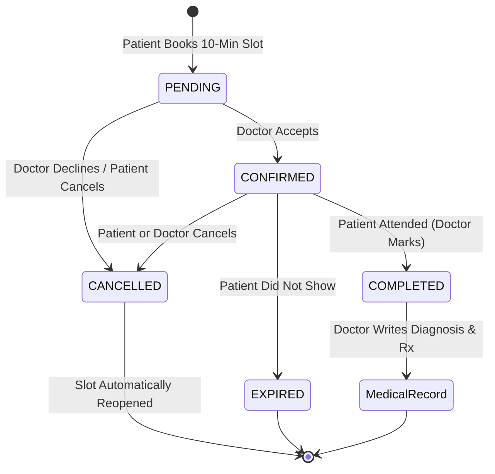

<div align="center">

<!-- Animated Header Banner -->


<!-- Dynamic Typing SVG Animation -->
<p align="center">
  <a href="https://github.com/Sreecharan01/Hospital-Management-System">
    
  </a>
</p>

<!-- Badges Strip -->
<p align="center">
  
  
  
  
  
  
  
  
</p>

<p align="center">
  <a href="#-key-features">Key Features</a> •
  <a href="#-system-architecture">Architecture</a> •
  <a href="#-appointment-lifecycle">Lifecycle Flow</a> •
  <a href="#-tech-stack">Tech Stack</a> •
  <a href="#-getting-started">Getting Started</a> •
  <a href="#-api-endpoints">API Docs</a> •
  <a href="#-testing">Testing</a>
</p>

</div>

---

## 🩺 Overview

The **Hospital Appointment Management System** is an enterprise-grade healthcare management application designed to streamline the appointment booking, confirmation, and medical consultation pipeline. Built with **Django REST Framework** on the backend and **React + Vite + Tailwind CSS** on the frontend, it provides a high-reliability booking experience with concurrency safeguards, precise **10-minute slot scheduling**, and transparent doctor-patient interactions.

---

## ✨ Key Features

<table>
  <tr>
    <td width="50%">
      <h3>⏱️ 10-Minute Smart Booking</h3>
      <ul>
        <li>Doctor availability windows broken into selectable <b>10-minute intervals</b>.</li>
        <li>Real-time slot availability indicators (active vs. booked).</li>
        <li>Instant visual alerts and API validation preventing duplicate bookings.</li>
      </ul>
    </td>
    <td width="50%">
      <h3>🤝 Doctor Acceptance Workflow</h3>
      <ul>
        <li>Appointments begin in <code>PENDING</code> status upon booking.</li>
        <li>Doctor reviews and can <b>Accept</b> (<code>CONFIRMED</code>) or <b>Decline</b>.</li>
        <li>Attended appointments transition to <code>COMPLETED</code>; no-shows become <code>EXPIRED</code>.</li>
      </ul>
    </td>
  </tr>
  <tr>
    <td width="50%">
      <h3>🛡️ Concurrency & Overlap Protection</h3>
      <ul>
        <li><code>SELECT FOR UPDATE</code> database locking during booking transactions.</li>
        <li>Conditional unique constraints permitting re-booking of cancelled time slots.</li>
        <li>Role-based access control protecting medical history and slot modifications.</li>
      </ul>
    </td>
    <td width="50%">
      <h3>📬 Notifications & Background Tasks</h3>
      <ul>
        <li>In-app notifications for patients and doctors upon booking and state changes.</li>
        <li>Asynchronous transactional email confirmations dispatched via <b>Celery</b>.</li>
        <li><b>Celery Beat</b> cron scheduler dispatching 24-hour pre-appointment reminders.</li>
      </ul>
    </td>
  </tr>
  <tr>
    <td width="50%">
      <h3>📋 Digital Medical Records</h3>
      <ul>
        <li>Doctors generate diagnosis, prescriptions, and follow-up notes post-visit.</li>
        <li>Strict one-record-per-appointment rule to preserve audit integrity.</li>
        <li>Secure patient portal for accessing historical consultations.</li>
      </ul>
    </td>
    <td width="50%">
      <h3>📊 Admin Analytics Dashboard</h3>
      <ul>
        <li>Interactive consultation analytics with <b>Recharts</b>.</li>
        <li>Doctor verification pipeline for regulatory onboarding.</li>
        <li>System-wide broadcast announcements via push notifications and bulk email.</li>
      </ul>
    </td>
  </tr>
</table>

---

## 🔄 Appointment Lifecycle



---

## 🛠️ Tech Stack

<div align="center">

<a href="https://skillicons.dev">
  
</a>

</div>

<br/>

| Layer | Technologies | Highlights |
|---|---|---|
| **Frontend** | React 18, Vite, Tailwind CSS, Lucide React, Axios | Responsive healthcare UI, interactive time-grid selector, live status badges |
| **Backend** | Python 3.12, Django 4.2, Django REST Framework | RESTful API, SimpleJWT authentication, atomic transactional locks |
| **Async Workers** | Celery, Redis | Event-driven status email dispatch, periodic appointment reminder scheduler |
| **Database** | PostgreSQL / SQLite | Partial unique constraints, foreign key cascades, JSON query support |
| **Testing** | Django Test Runner, unittest | 46 comprehensive unit & integration tests covering edge cases |

---

## 📂 Project Structure

```bash
Hospital management/
├── backend/
│   ├── config/              # Project settings, Celery app, URL routing
│   │   ├── settings.py      # Environment config & DRF settings
│   │   ├── celery.py        # Celery broker configuration
│   │   └── urls.py          # API route definitions & Swagger schema
│   ├── core/                # Core hospital domain
│   │   ├── models.py        # User, Doctor, Patient, Slot, Appointment, Records
│   │   ├── views.py         # ViewSets (Auth, Doctors, Appointments, Records)
│   │   ├── serializers.py   # Serializers with 10-minute interval validation
│   │   ├── tasks.py         # Celery tasks (reminders & transactional emails)
│   │   ├── tests.py         # 46 automated integration & unit tests
│   │   └── migrations/      # Versioned schema migrations
│   ├── manage.py
│   └── requirements.txt
├── frontend/
│   ├── src/
│   │   ├── components/      # Reusable UI (Navbar, Badges, Modals, Spinners)
│   │   ├── contexts/        # AuthContext & persistent token session state
│   │   ├── pages/           # DoctorDashboard, DoctorDetail, MyAppointments, Admin
│   │   └── api/axios.js     # Axios instance with JWT interceptors
│   ├── package.json
│   └── vite.config.js
└── docker-compose.yml       # Local PostgreSQL + Redis infrastructure
```

---

## 🚀 Getting Started

<details open>
<summary><b>1. Prerequisites & Infrastructure</b></summary>

Make sure you have installed:
- [Python 3.10+](https://www.python.org/)
- [Node.js 18+](https://nodejs.org/)
- [Docker Desktop](https://www.docker.com/) (for Postgres & Redis)

Start database & message broker:
```bash
docker-compose up -d
```
*Starts PostgreSQL on port `5432` and Redis on port `6379`.*

</details>

<details open>
<summary><b>2. Backend Setup (Django + Celery)</b></summary>

```bash
# Navigate to backend directory
cd backend

# Create & activate virtual environment
python -m venv venv
venv\Scripts\activate       # On Windows
# source venv/bin/activate  # On macOS/Linux

# Install dependencies
pip install -r requirements.txt

# Configure environment variables
cp .env.example .env

# Apply database migrations
python manage.py migrate

# Seed sample data (Specialties, Doctors, Patients, Slots, Admin)
python manage.py seed_data

# Start the Django development server
python manage.py runserver
```
- API Base URL: `http://localhost:8000/api/`
- Interactive Swagger Docs: `http://localhost:8000/api/docs/`

#### Start Background Workers (Optional for Local Email/Reminders)
```bash
# Celery worker (processes async emails)
celery -A config worker -l info --pool=solo

# Celery beat (processes 24h reminders)
celery -A config beat -l info
```

</details>

<details open>
<summary><b>3. Frontend Setup (React + Vite)</b></summary>

```bash
# Navigate to frontend directory
cd frontend

# Install npm dependencies
npm install

# Start Vite dev server
npm run dev
```
- Web Application: `http://localhost:5173`

</details>

---

## 🔑 Default Seed Credentials

After running `python manage.py seed_data`, you can sign in with:

| Role | Email | Password | Permissions |
|---|---|---|---|
| **Admin** | `admin@hospital.com` | `Admin123!` | System stats, verify doctors, broadcast announcements |
| **Doctor** | `dr.smith@hospital.com` | `Doctor123!` | Manage slots, accept/decline bookings, attend/expire, write records |
| **Patient** | `patient.alice@example.com` | `Patient123!` | Browse doctors, select 10-min slots, reschedule, view records |

---

## 📡 API Reference

<details>
<summary><b>View API Endpoints</b></summary>

### Authentication
- `POST /api/auth/register/` — Register user & profile (`PATIENT` or `DOCTOR`)
- `POST /api/auth/token/` — Obtain JWT access & refresh tokens
- `GET/PATCH /api/auth/me/` — Retrieve or update current user profile

### Appointments & Slots
- `GET /api/doctors/` — List verified doctors (search by name, specialty, day)
- `GET /api/doctors/{id}/` — Doctor details including availability slots
- `GET /api/appointments/available-times/?slot=<id>&date=<YYYY-MM-DD>` — Get all 10-minute intervals with availability
- `POST /api/appointments/` — Book a 10-minute slot (starts as `PENDING`)
- `POST /api/appointments/{id}/confirm/` — Doctor confirms appointment
- `POST /api/appointments/{id}/complete/` — Doctor marks patient as attended
- `POST /api/appointments/{id}/expire/` — Doctor marks appointment expired (no-show)
- `POST /api/appointments/{id}/cancel/` — Cancel appointment (frees slot)
- `POST /api/appointments/{id}/reschedule/` — Reschedule to a new slot & 10-min interval

### Medical Records & Admin
- `GET /api/records/` — Access medical consultation history
- `POST /api/records/` — Doctor writes record for attended appointment
- `GET /api/admin/stats/` — System analytics for admin dashboard
- `POST /api/admin/announce/` — Broadcast message to user roles

</details>

---

## 🧪 Automated Testing

The backend includes a comprehensive test suite of 46 automated tests validating business rules, overlap detection, permission boundaries, and concurrency constraints.

```bash
cd backend
python manage.py test core.tests -v 2
```

```
Found 46 test(s).
System check identified no issues (0 silenced).
..............................................
----------------------------------------------------------------------
Ran 46 tests in 8.504s

OK
```

---

<div align="center">

<!-- Animated Footer Wave -->


<sub>Built with ❤️ for modern healthcare management.</sub>

</div>
